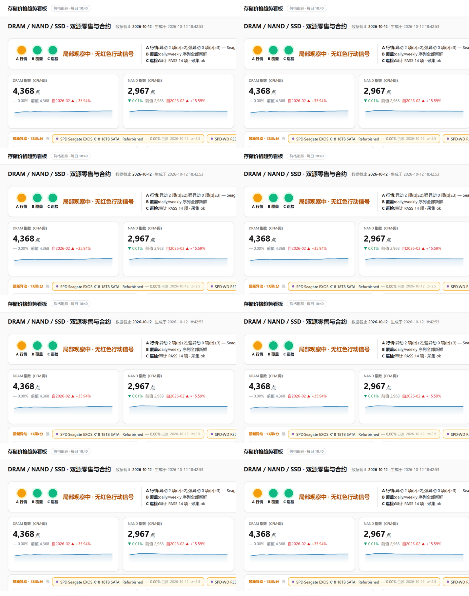
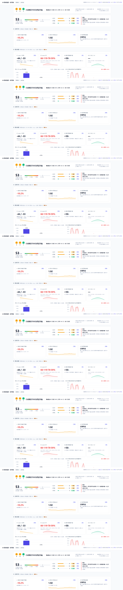
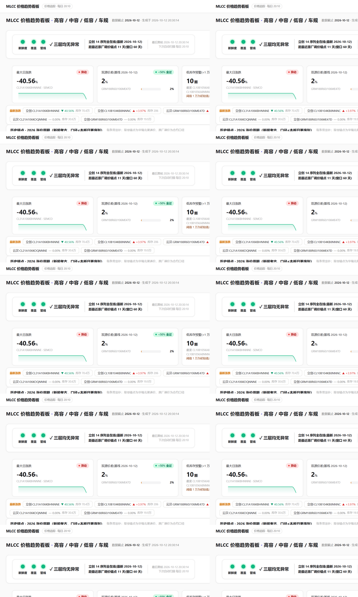
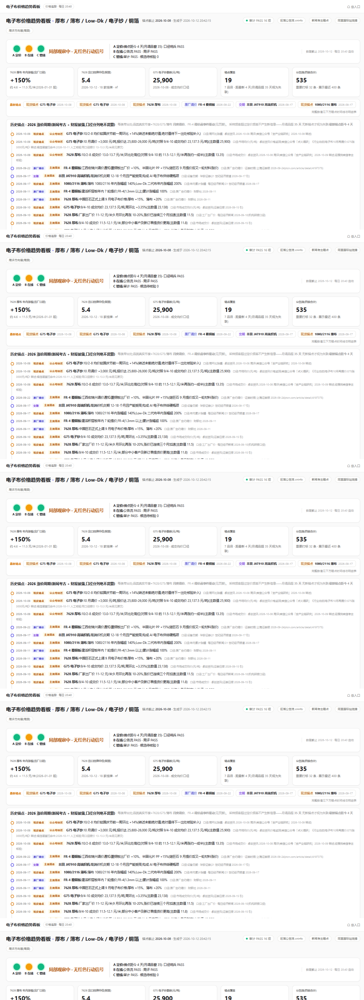

# Self-hosted price boards for the AI hardware supply chain

**中文说明见下方 / 中文使用说明在文末。**

Four self-hosted dashboards that track the 2026 AI-hardware price cycle at the
material layer — DRAM/NAND spot & contract, MLCC distributor prices, glass
fabric boards — plus a signal board that watches for **cycle exit signals**.

> **Data discipline (the point of this repo):** anchors, not curves. Calibers
> never mixed. Machines present phenomena; humans decide. If a source has no
> price today, the board records *no* price — never an interpolation.

## Screenshots

| Storage (8790) | Signal — exit lamps (8794) |
|---|---|
|  |  |
| **MLCC (8792)** | **Fabric (8793)** |
|  |  |

## Boards

| Board | Port | Tracks | Sources |
|---|---|---|---|
| [storage](boards/storage/) | 8790 | DRAM/NAND spot & contract, channel SSD | CFM 闪存市场 · TrendForce · DRAMeXchange · ServerPartDeals |
| [mlcc](boards/mlcc/) | 8792 | MLCC distributor prices (LCSC/Mouser/ICKey) | LCSC · ICKey · Mouser |
| [fabric](boards/fabric/) | 8793 | Glass-fabric board (电子布) prices | TrendForce · 巨潮公告流 · 阿里国际站 |
| [signal](boards/signal/) | 8794 | AI capex & exit signals | SEC 8-K XBRL · CSP capex ledger · 新浪美股 |

All sources are public pages, no API keys, no login.

## Quick start

```bash
python -m pip install -r requirements.txt
# optional browser scrapers:
#   python -m playwright install chromium

# seed synthetic demo data (no network):
python -m scripts.make_demo_data

# or run a real first collection (3-5 min per board):
python -m boards.storage.tracker.update
python -m boards.storage.tracker.audit    # expect PASS

python -m boards.storage.serve            # http://127.0.0.1:8790
```

Per-board instructions: [boards/*/README.md](boards/). Agent-facing
instructions: [AGENTS.md](AGENTS.md).

## Architecture

```
scraper (tracker/*.py, circuit-breaker discipline)
   → SQLite (data/*.db, auto-created, git-ignored)
   → audit (hard-FAIL rules: monotonic ladders, dual-source spread, staleness)
   → dashboard (static js + data.js export)
   → scheduler (Windows schtasks / cron — once daily, that's enough)
```

See [docs/architecture.md](docs/architecture.md) for the full data flow,
[docs/data-sources.md](docs/data-sources.md) for the source matrix, and
[docs/add-your-own-board.md](docs/add-your-own-board.md) to add a board for
your own market.

## The exit-signal board (why it exists)

The signal board tracks three independent evidence layers for the AI-hardware
trade — **pricing behavior** (market votes first), **growth quality** (capex
second-derivative, FCF quality), **structural phenomena** (LTA terms,边际买家).
A lamp turns amber when a layer detects something; it turns red only on
**cross-layer resonance** — independent evidence chains pointing the same way.
The board presents these phenomena; it never outputs an exit probability.
Decisions belong to the human.

## 中文说明

四个自托管看板,跟踪 AI 硬件供应链材料层价格:存储(DRAM/NAND/SSD)、MLCC、
电子布,外加一块 AI 需求与退出信号板。设计纪律:**历史必须真实(锚点制、
不插值)、口径分列绝不混算、机器只呈现现象、行动由人决定**。

- 冷启动:`pip install -r requirements.txt` → 各板 `python -m tracker.update`
  (首跑 3-5 分钟)→ `python -m tracker.audit` → `python serve.py`。
- 首跑后审计的覆盖类检查可能 FAIL,属数据累积期预期,随每日运行转 PASS。
- 数据源均为公开页、无需登录;数据文件不入仓库(版权归各数据商),本地自跑自累积。
- Windows 建议设置 `PYTHONIOENCODING=utf-8`。定时任务示例见各板 README。

## License

MIT for the code. Collected price data is **not** distributed with this
repository and remains the property of the respective data providers
(CFM / TrendForce / DRAMeXchange / 巨潮资讯). Manual ledger CSVs are the
author's original research notes. This project is not affiliated with any
of the data providers.
